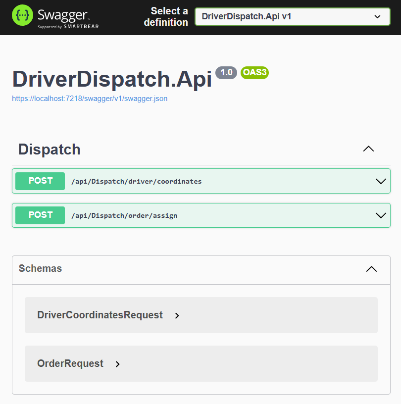
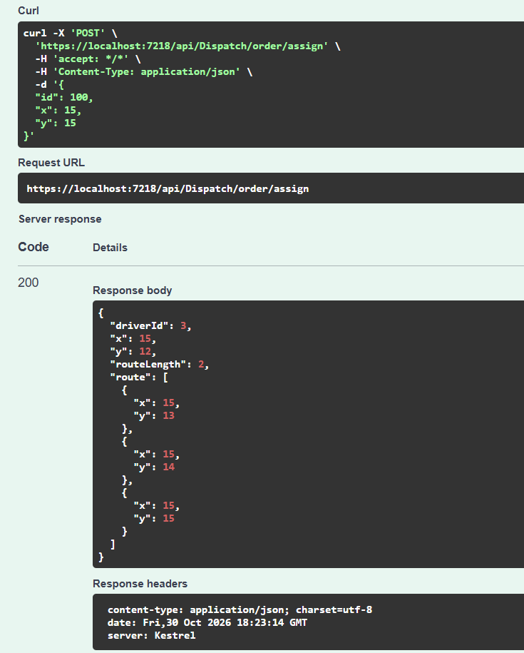
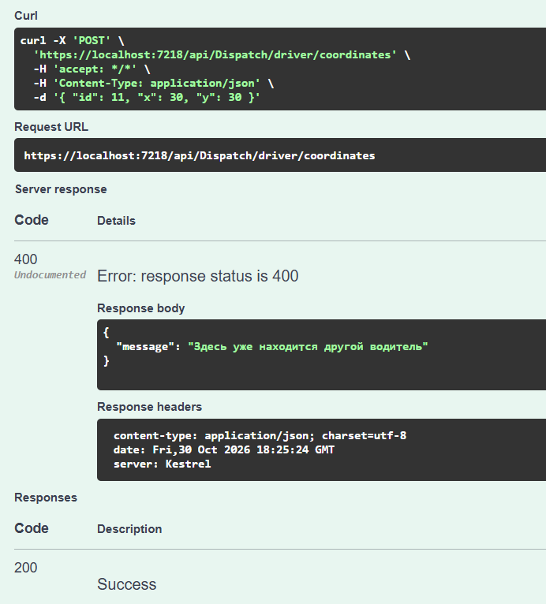

## Часть 2: ASP.NET Core Web API

### Конфигурация

В `DriverDispatch.Api/appsettings.json`:
- `MapSettings:N` и `MapSettings:M` — размеры карты.
- `Settings:ParallelLimit` — максимальное число одновременно обрабатываемых запросов.

### Эндпоинты

- `POST /api/dispatch/driver/coordinates` — добавление/изменение координат водителя.
- `POST /api/dispatch/order/assign` — подбор водителя на заказ.

### Ограничение параллельных запросов

Реализовано собственное middleware (`ParallelLimitMiddleware`), которое считает текущее число запросов через `Interlocked`. При превышении `ParallelLimit` возвращается HTTP 503.

### Скриншоты

