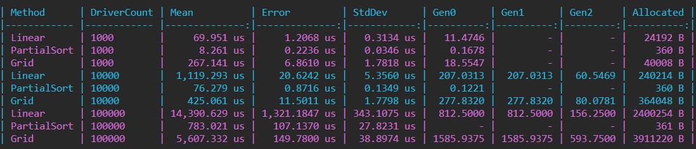

# DriverDispatch

Подбор водителей на заказ. Карта - прямоугольная сетка N x M, в каждой клетке не более одного водителя. Координаты - целые числа X, Y, где 0 <= X < N, 0 <= Y < M. Каждый водитель имеет уникальный идентификатор.

## Структура решения

- DriverDispatch.Core - модели, интерфейс и алгоритмы поиска.
- DriverDispatch.Console - демонстрация работы (часть 1).
- DriverDispatch.Tests - NUnit-тесты для всех алгоритмов.
- DriverDispatch.Benchmarks - BenchmarkDotNet для сравнения производительности.
- DriverDispatch.Api - ASP.NET Core Web API (часть 2).

## Алгоритмы поиска ближайших водителей

1. LinearSearchAlgorithm - вычисляет квадрат расстояния до всех водителей и полностью сортирует список. Сложность O(n log n).
2. PartialSortAlgorithm - держит max-heap размера k (через PriorityQueue с инвертированным приоритетом), заменяет худшего кандидата, если найден более близкий. Сложность O(n log k).
3. GridSearchAlgorithm - использует сеточную структуру карты: строит индекс "координата - водитель" и обходит кольца вокруг заказа, пока не наберёт k водителей.

## Запуск

Демонстрация:

    dotnet run --project DriverDispatch.Console

Тесты:

    dotnet test

Бенчмарки (обязательно в Release):

    dotnet run -c Release --project DriverDispatch.Benchmarks

Web API:

    dotnet run --project DriverDispatch.Api

После запуска API откройте Swagger UI: https://localhost:7218/swagger

## Результаты бенчмарков (часть 1)

Сравнение производительности трёх алгоритмов (BenchmarkDotNet, .NET 6, Release):

### Выводы

- PartialSortAlgorithm - самый быстрый: O(n log k) и почти нулевые аллокации (константные 360 B).
- LinearSearchAlgorithm - проигрывает по времени (O(n log n)) и аллоцирует память под список кандидатов.
- GridSearchAlgorithm - на разреженной карте 1000x1000 проигрывает: обход колец делает много пустых проверок Dictionary.TryGetValue, а индекс строится на каждый вызов.

Для Web API (часть 2) выбран PartialSortAlgorithm как лучший по производительности.

## Часть 2: ASP.NET Core Web API

### Конфигурация

В DriverDispatch.Api/appsettings.json:

- MapSettings:N и MapSettings:M - размеры карты.
- Settings:ParallelLimit - максимальное число одновременно обрабатываемых запросов.

### Эндпоинты

- POST /api/dispatch/driver/coordinates - добавление/изменение координат водителя.
- POST /api/dispatch/order/assign - подбор водителя на заказ.

### Ограничение параллельных запросов

Реализовано собственное middleware (ParallelLimitMiddleware), которое считает текущее число запросов через Interlocked. При превышении ParallelLimit возвращается HTTP 503.

### Скриншоты

